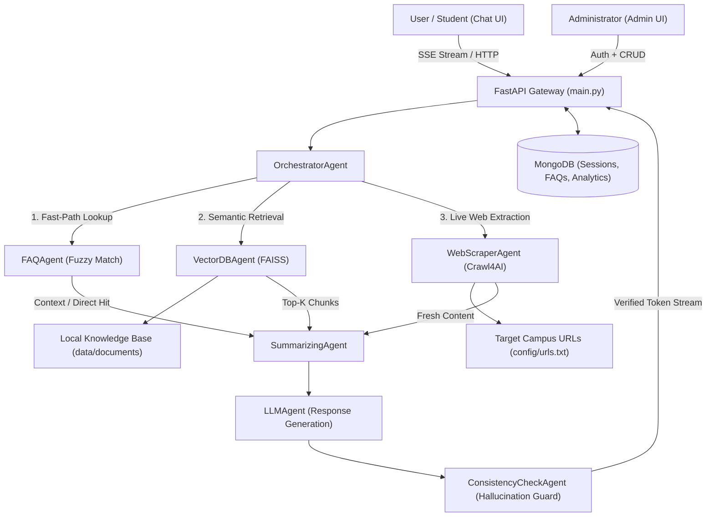

# EDU Assist — Multi-Agent RAG System

[](LICENSE)
[](https://www.python.org/)
[](https://fastapi.tiangolo.com/)
[](Dockerfile)

A production-oriented, Dockerized **Multi-Agent Retrieval-Augmented Generation (RAG)** assistant designed for university campus knowledge workflows. Built on **FastAPI**, **LangChain**, **FAISS**, **Crawl4AI**, and **MongoDB**, it streams low-latency responses over Server-Sent Events (SSE) while routing queries through specialized autonomous agents with hallucination guardrails.

---

## System Architecture



---

## Key Capabilities

- **Multi-Agent Orchestration**: Modular agent hierarchy (`OrchestratorAgent`, `FAQAgent`, `VectorDBAgent`, `WebScraperAgent`, `SummarizingAgent`, `LLMAgent`, `ConsistencyCheckAgent`) decoupling retrieval, synthesis, and verification.
- **Real-Time SSE Streaming**: Token-by-token streaming via FastAPI Server-Sent Events for responsive conversational UX.
- **Hybrid Knowledge Retrieval**: Combines local **FAISS** vector search over institutional documents (PDF, TXT, DOCX) with live web extraction via **Crawl4AI**.
- **Cost & Hallucination Guardrails**: High-frequency FAQ fast-path bypasses unnecessary LLM calls, while `ConsistencyCheckAgent` validates groundedness before final delivery.
- **Admin Operations Dashboard**: Authenticated web console for query analytics, unanswered-query triage, FAQ CRUD management, target URL maintenance, and manual FAISS re-indexing.
- **Containerized Deployment**: Turnkey multi-container orchestration via `Dockerfile` and `docker-compose.yml` (FastAPI app + MongoDB with persistent volumes).

---

## Technology Stack

| Layer | Technologies |
| :--- | :--- |
| **API & Streaming** | FastAPI, Uvicorn, Server-Sent Events (SSE) |
| **Agent & LLM Layer** | LangChain, HuggingFace Transformers, PyTorch |
| **Vector Search** | FAISS (local persistent index) |
| **Web & Document Ingestion** | Crawl4AI, BeautifulSoup4, PyMuPDF (`fitz`), PyPDF2 |
| **Persistence & Analytics** | MongoDB |
| **Infrastructure & CI** | Docker, Docker Compose, GitHub Actions (`ruff` + compile checks) |

---

## Project Structure

```text
edu-assist-multiagent-rag/
├── .github/workflows/ci.yml       # Lint & syntax verification CI
├── admin/                         # Admin logging and analytics handlers
├── agents/                        # Specialized autonomous agents
│   ├── orchestrator_agent.py      # Central routing & coordination
│   ├── faq_agent.py               # Fast-path fuzzy-match FAQ retrieval
│   ├── vectordb_agent.py          # Local FAISS document RAG retrieval
│   ├── webscraper_agent.py        # Live website extraction (Crawl4AI)
│   ├── summarizing_agent.py       # Context compression & synthesis
│   ├── llm_agent.py               # LLM generation interface
│   └── consistency_check_agent.py # Groundedness & hallucination check
├── config/                        # Application settings and target URLs
├── data/                          # Knowledge documents & persisted FAISS volume
├── static/                        # Chat UI and Admin Dashboard frontend
├── utils/                         # MongoDB session/settings & UI helpers
├── main.py                        # FastAPI entry point & SSE endpoints
├── pipeline.py                    # Orchestrator initialization
├── Dockerfile                     # Production container image
├── docker-compose.yml             # Multi-container stack (App + MongoDB)
├── requirements.txt               # Python dependencies
└── LICENSE                        # MIT License
```

---

## Quick Start

### Option 1: Docker Compose (Recommended)

```bash
git clone https://github.com/mirzahammad1/edu-assist-multiagent-rag.git
cd edu-assist-multiagent-rag
cp .env.docker.example .env
docker compose up --build -d
```

Inspect logs:
```bash
docker compose logs -f app
```

### Option 2: Local Development

```bash
git clone https://github.com/mirzahammad1/edu-assist-multiagent-rag.git
cd edu-assist-multiagent-rag

python3 -m venv .venv
source .venv/bin/activate  # Windows: .venv\Scripts\activate
pip install -r requirements.txt

cp .env.example .env
uvicorn main:app --host 0.0.0.0 --port 8000 --reload
```

### Service Endpoints
- **Chat Interface:** `http://localhost:8000/chat`
- **Admin Dashboard:** `http://localhost:8000/admin`
- **Interactive API Docs:** `http://localhost:8000/docs`

---

## License

This project is licensed under the [MIT License](LICENSE).
